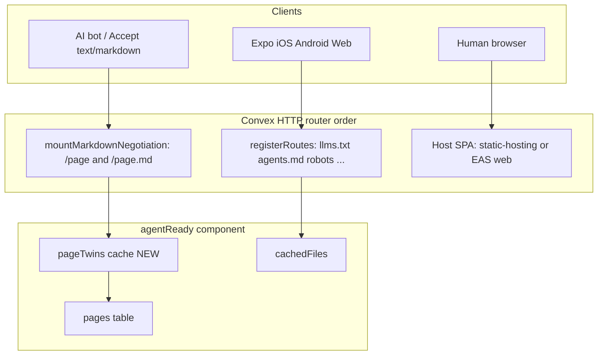

# Dualmark markdown twins + Expo support

## Context

Two gaps drive this work:

1. **Dualmark gap (from prior analysis):** [`markdownNegotiation`](src/client/index.ts) only sets `Vary: Accept` on discovery routes. The PRD-specified [`mountMarkdownNegotiation`](prds/agent-readiness-v1.md) was never shipped, so bots hitting SPA routes (e.g. `/pricing`) still get HTML shells. [`scan`](cli/commands/scan.mjs) probes `/` with `Accept: text/markdown` and can pass/fail misleadingly vs actual behavior.

2. **Expo gap:** The package targets React/Vite and SvelteKit only. [Expo docs](https://docs.expo.dev/) already publish [`llms.txt`](https://docs.expo.dev/llms.txt) and [`llms-full.txt`](https://docs.expo.dev/llms-full.txt) for AI agents. Convex + Expo Router apps have no documented path, no setup wizard option, and no universal widget.

## Architecture



**Hosting note for Expo:** Discovery files always live on the Convex `.site` URL. Expo web on [EAS Hosting](https://expo.dev/) is often a different origin. Reuse the existing `publicAppUrl` / `EXPO_PUBLIC_SITE_URL` split: widget and copy links point at the public app domain; fetches hit `EXPO_PUBLIC_CONVEX_SITE_URL`.

---

## Phase 1: Dualmark-style markdown twins (core)

### 1.1 Add negotiation primitives in [`src/component/lib.ts`](src/component/lib.ts)

- `parseAcceptHeader(header: string): { prefersMarkdown: boolean }` — RFC 7231 quality parsing for `text/markdown`
- `shouldServeMarkdown(req: Request): boolean` — true when Accept prefers markdown **or** `classifyUserAgent()` matches a known AI bot
- `buildMarkdownTwinBody(page, settings)` — title, description, breadcrumb, `fullContent` or description fallback
- `pagePathToTwinPath(path: string): string` — `/pricing` → `/pricing.md` (root `/` → `/index.md` or skip twin URL; document choice in spec)

### 1.2 Page twin cache in schema

Add to [`src/component/schema.ts`](src/component/schema.ts):

```typescript
pageTwins: defineTable({
  path: v.string(), // canonical page path, e.g. "/pricing"
  markdown: v.string(),
  generatedFromVersion: v.string(),
  generatedAt: v.number(),
}).index("by_path", ["path"]);
```

Wire regeneration in [`src/component/generation.ts`](src/component/generation.ts): for each published page with content, upsert twin rows during `runGeneration`. Invalidate on `upsertPage` / `deletePage` via existing dirty flag.

### 1.3 Ship `mountMarkdownNegotiation`

New export from [`src/client/index.ts`](src/client/index.ts):

```typescript
mountMarkdownNegotiation(http, component, options?: {
  pathPrefix?: string;          // default "/"
  beforeStaticFallback?: true; // documented requirement
})
```

Handler behavior (aligned with [Dualmark spec](https://dualmark.dev)):

| Trigger                                            | Response                             |
| -------------------------------------------------- | ------------------------------------ |
| `GET /pricing.md`                                  | Markdown twin for `/pricing`         |
| `GET /pricing` + bot UA or `Accept: text/markdown` | Same markdown body                   |
| Draft/archived/missing page                        | Fall through (`null` → next handler) |
| `testMode` + non-localhost                         | 403 (same as discovery routes)       |

Response headers on markdown twins:

- `Content-Type: text/markdown; charset=utf-8`
- `X-Robots-Tag: noindex`
- `x-markdown-tokens`, `Content-Signal`, `Vary: Accept`, `ETag`
- Optional `Link: <html-url>; rel="canonical"` when `publicAppUrl` differs

Register **after** `registerRoutes`, **before** static/SPA fallback in [`example-react/convex/http.ts`](example-react/convex/http.ts) and Svelte demo.

### 1.4 Discovery header upgrades

In [`buildAgentHeaders`](src/client/index.ts) / [`buildDiscoveryLinkHeader`](src/component/lib.ts):

- Add per-page twins to sitemap when `markdownNegotiation` enabled
- Extend `Link` headers on HTML-facing discovery routes to advertise `llms-full.txt` and feed when enabled
- Document Dualmark interop: optional `scan --dualmark` checks subset of [dualmark verify](https://github.com/dodopayments/dualmark) catalog

### 1.5 Fix verification honesty

**[`cli/commands/scan.mjs`](cli/commands/scan.mjs):**

- Replace root `/` probe with a configured page path from `agent-ready.config.json` (first published page with `fullContent`, fallback `/`)
- Add `--strict` mode: bot UA test, Accept test, `.md` twin fetch, `X-Robots-Tag: noindex`, `Link rel=alternate`
- Exit non-zero when negotiation flag is on but probes fail

**[`buildReadinessRoute`](src/client/index.ts):**

- Split `markdown_negotiation` into config check (5 pts) + live probe check (5 pts) when a probe page exists
- Add checks: `page_twins_cached`, `markdown_noindex_header`

### 1.6 Auto-fallback content

When `fullContent` is missing, generate thin twin from `title + description` so negotiation is not a no-op for minimal configs. Warn in readiness when >50% of pages lack `fullContent`.

---

## Phase 2: Expo React Native widget

### 2.1 New export `@waynesutton/agent-ready/expo`

| File                                                                       | Purpose                                                                                                 |
| -------------------------------------------------------------------------- | ------------------------------------------------------------------------------------------------------- |
| [`src/expo/AgentReadyWidget.tsx`](src/expo/AgentReadyWidget.tsx)           | RN implementation: `View`, `Text`, `Pressable`, `Linking`, `StyleSheet`                                 |
| [`src/expo/useAgentReadyStatus.ts`](src/expo/useAgentReadyStatus.ts)       | Fetch-based status hook (mirror [`src/react/useAgentReadyStatus.ts`](src/react/useAgentReadyStatus.ts)) |
| [`src/expo/useAgentReadyReadiness.ts`](src/expo/useAgentReadyReadiness.ts) | Poll `/llms-readiness`                                                                                  |
| [`src/expo/index.ts`](src/expo/index.ts)                                   | Barrel export                                                                                           |

**Widget contract:** Match props from [`CONTRIBUTING.md`](CONTRIBUTING.md) (`appUrl`, `publicAppUrl`, `position`, `theme`, all `show*` flags, `colors`). Map `colors` to RN styles instead of CSS custom properties.

**Platform behavior:**

- iOS/Android: compact floating tab bar; `Linking.openURL` for file URLs and AI chat deep links
- Web: reuse layout patterns from React widget where possible
- Safe area: respect `useSafeAreaInsets()` on native

**Package changes in [`package.json`](package.json):**

```json
"./expo": {
  "types": "./dist/expo/index.d.ts",
  "import": "./dist/expo/index.js"
}
```

Add optional peer: `react-native`, `react-native-safe-area-context` (Expo includes both).

### 2.2 CLI setup wizard

Update [`cli/commands/setup.mjs`](cli/commands/setup.mjs):

- Add `"expo"` to `WIDGET_FRAMEWORKS`
- `rootLayoutFile("expo")` → `app/_layout.tsx`
- Env guidance: `EXPO_PUBLIC_CONVEX_URL`, `EXPO_PUBLIC_CONVEX_SITE_URL`, `EXPO_PUBLIC_SITE_URL`
- Widget install snippet for Expo Router root layout

### 2.3 Expo route discovery

Extend [`cli/commands/discover.mjs`](cli/commands/discover.mjs):

- Scan `app/` directory (Expo Router conventions: `index.tsx`, `[slug].tsx`, `(groups)/`)
- Map file paths → page entries for `agent-ready.config.json`
- Suggest `fullContent` import from co-located markdown if present

---

## Phase 3: `example-expo` demo workspace

New workspace at `example-expo/` (added to root [`package.json`](package.json) workspaces):

```
example-expo/
  app/_layout.tsx          ConvexProvider + AgentReadyWidget
  app/(tabs)/index.tsx     Landing
  app/(tabs)/settings.tsx  Settings (auth-gated, mirrors React demo)
  app/(tabs)/analytics.tsx Analytics
  convex/                  Same component wiring as example-react
  agent-ready.config.json
  app.json
  package.json             expo, expo-router, convex, @waynesutton/agent-ready
```

**Convex wiring:** Copy pattern from [`example-react/convex/http.ts`](example-react/convex/http.ts):

```typescript
registerRoutes(http, components.agentReady, { ... });
mountMarkdownNegotiation(http, components.agentReady, {}); // NEW
// No static-hosting — Expo web deploys via EAS separately
```

**Scripts:**

- `dev`: `node setup.mjs && npx convex dev --start 'npx expo start'`
- `deploy:web`: `eas deploy` (document in SETUP.md)
- `deploy:full`: convex deploy + agent-ready sync/regenerate

**Demo pages:** Include at least one page with `fullContent` so markdown twin + strict scan have a real target.

---

## Phase 4: Documentation and project hygiene

Per [workflow rules](.cursor/rules/workflow.mdc):

1. **PRD:** [`prds/dualmark-twins-and-expo-support.md`](prds/dualmark-twins-and-expo-support.md) — problem, architecture, edge cases (EAS vs Convex origin, native widget safe areas, route order)
2. **INTEGRATION.md:** New sections
   - Markdown twins + `mountMarkdownNegotiation` + route order diagram
   - Expo + Convex quick start (env vars, widget mount, EAS web deploy)
   - Dualmark interop (complementary positioning, link to [dualmark.dev](https://dualmark.dev))
3. **README.md:** Add Expo to supported frameworks; mention per-page `.md` twins
4. **SETUP.md:** Author steps for `example-expo` dev and EAS deploy
5. **TASK.md / changelog.md / files.md:** Update on completion
6. **Run `npx convex-doctor@latest`** after Convex changes (maintain 100/100)

---

## Key files to change

| Area           | Files                                                                                                                                                                                                                                                                                                                  |
| -------------- | ---------------------------------------------------------------------------------------------------------------------------------------------------------------------------------------------------------------------------------------------------------------------------------------------------------------------- |
| Markdown twins | [`src/component/schema.ts`](src/component/schema.ts), [`src/component/generation.ts`](src/component/generation.ts), [`src/component/content.ts`](src/component/content.ts), [`src/component/lib.ts`](src/component/lib.ts), [`src/client/index.ts`](src/client/index.ts), [`src/client/types.ts`](src/client/types.ts) |
| Verification   | [`cli/commands/scan.mjs`](cli/commands/scan.mjs)                                                                                                                                                                                                                                                                       |
| Expo widget    | `src/expo/*`, [`package.json`](package.json), [`tsconfig.build.json`](tsconfig.build.json)                                                                                                                                                                                                                             |
| Demo           | `example-expo/**`                                                                                                                                                                                                                                                                                                      |
| CLI            | [`cli/commands/setup.mjs`](cli/commands/setup.mjs), [`cli/commands/discover.mjs`](cli/commands/discover.mjs)                                                                                                                                                                                                           |
| Docs           | [`INTEGRATION.md`](INTEGRATION.md), [`README.md`](README.md), [`SETUP.md`](SETUP.md), [`CONTRIBUTING.md`](CONTRIBUTING.md)                                                                                                                                                                                             |

---

## Out of scope (v1)

- Full Dualmark spec fork or `@dualmark/converters` port (reference spec only)
- Native-only Expo apps with no web build (docs note: discovery files still work; widget optional)
- EAS edge middleware adapter (document as future; Convex twins cover `.convex.site` paths)
- Vue/Solid widgets

---

## Verification checklist

- `npx agent-ready scan --url <demo> --strict` passes with negotiation enabled
- `curl -H "User-Agent: GPTBot" https://<site>/pricing` returns markdown
- `curl https://<site>/pricing.md` returns markdown with `X-Robots-Tag: noindex`
- `example-expo` runs on iOS simulator, Android emulator, and web
- Widget renders on all three platforms; copy links use `EXPO_PUBLIC_SITE_URL`
- `npx convex-doctor@latest` → 100/100
- Existing React/Svelte demos unchanged except `mountMarkdownNegotiation` added to `http.ts`
