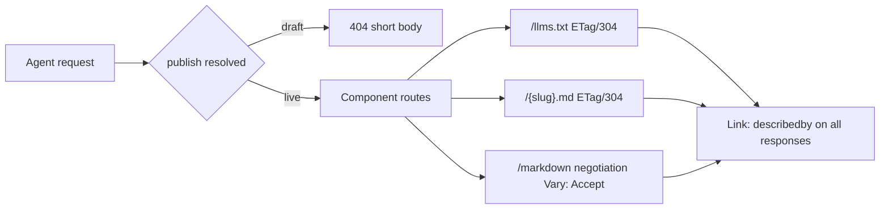

# Simple-mode-first migration to 0.3.0

Implements the migration prompt from the compass artifact, adapted to the real repo (verified in Phase 0 inventory). Backward compatible minor bump: `0.2.6` -> `0.3.0`.

## Verified starting point

- Component: `defineComponent("agentReady")` in [src/component/convex.config.ts](src/component/convex.config.ts); routes registered via `registerRoutes` / `registerMarkdownRoutes` from [src/client/index.ts](src/client/index.ts)
- `testMode` defaults `true` (insert in [src/component/content.ts](src/component/content.ts) line 55) and gates file routes with **403** at `src/client/index.ts:271-276`, readiness at 421-426, markdown at 699-700
- Link/Content-Signal headers exist in `buildAgentHeaders` but Link only fires when `discoveryHeaders` flag is on; markdown site routes get no Link header at all
- Accept-negotiation helpers exist (`parseAcceptPrefersMarkdown`, `shouldServeMarkdown`) but are never called
- No `/{site-name}.md` route, no `AgentLinks` component, no head-injection, no console nudge
- CLI `go-live` flips `testMode: false` via `content:upsertSettings`

## Phase 1: simple mode, live by default

- Add `publish?: "live" | "draft"` to settings schema/validators ([src/component/schema.ts](src/component/schema.ts), [src/component/validators.ts](src/component/validators.ts), [src/client/types.ts](src/client/types.ts)). Resolution: explicit `publish` wins; else `testMode: true` maps to `"draft"`; else default `"live"`. Mark `testMode` with JSDoc `@deprecated` but keep it working.
- New default on insert: settings singleton defaults to live (`testMode ?? false` equivalent via resolved publish) in [src/component/content.ts](src/component/content.ts) and [src/component/contentInternal.ts](src/component/contentInternal.ts). Existing installs with stored `testMode: true` keep gating.
- Draft gating returns **404** with a short body (replaces the 403 path); localhost preview stays allowed. Update `buildFileRoute`, `buildReadinessRoute`, `gateTestMode`.
- New route `/{slug}.md`: slugify `appName` (lowercase, spaces to hyphens, strip unsafe chars), store resolved slug in settings/status so widget, AgentLinks, docs, and nudge all reference the same value. Serves a per-site markdown summary with ETag/304, collision-guarded against existing routes and `skipRoutes`.
- Zero-config `app.use(agentReady)` plus `registerRoutes` must serve `/llms.txt` and `/{slug}.md` with sensible defaults when no settings exist yet (derive fallback name from deployment, generate on first request or first codegen).
- CLI: `go-live` now sets `publish: "live"` (and clears `testMode`); wizard writes `publish: "live"` by default with a draft prompt; `status` prints publish state.

## Phase 2: discoverability

- Always-on `Link: </llms.txt>; rel="describedby"; type="text/markdown"` on every component-served response (file routes, status, readiness, markdown index/pages, `/{slug}.md`), appending to any existing Link header value rather than overwriting. Extend `buildAgentHeaders` and the markdown handlers in [src/client/index.ts](src/client/index.ts). Existing `discoveryHeaders` flag keeps adding its richer alternate links on top.
- HTML alternate tag, three paths:
  - Docs/copy-prompt: README instructs adding `<link rel="alternate" type="text/markdown" href="/{slug}.md" title="Markdown version">` to the app root layout (root-absolute href).
  - Widget fallback: shared `injectAlternateLink(slug)` util (new [src/client/headInjection.ts](src/client/headInjection.ts) or similar); React and Svelte widgets call it on mount, deduped by href.
  - Convex static hosting: document mounting order and provide guidance for injecting the tag into the hosted `index.html` (demos get the tag directly in `index.html` / `app.html`, which covers the static-hosting case concretely).

## Phase 3: content negotiation

- Wire `shouldServeMarkdownFromRequest` into the markdown site routes: `Accept: text/markdown` on `/markdown` and `/markdown/*` returns markdown, HTML twin otherwise (internal rewrite, no redirect). Set `Vary: Accept` on every negotiated response.
- `/{slug}.md` suffix path from Phase 1 stays the collision-guarded alternate URL. Collision guard logs a warning and skips rather than overwriting.

## Phase 4: advanced mode mapping

- Keep the existing flat flags (`fullTxtEnabled`, `robotsTxtEnabled`, `sitemapEnabled`, `agentSkillsEnabled`, `readinessEndpointEnabled`, `rssEnabled`, `analyticsEnabled`, `markdownSiteEnabled`, `contentSignals`, cron/wizard/settings panel) as the advanced surface; no new nested `advanced` block (adaptation permitted by the doc; avoids churn). All stay off unless enabled, existing enabled installs unchanged.
- Wizard defaults adjust to simple-first: `fullTxtEnabled` default `false` for new installs.

## Phase 5: advanced-mode discovery UX

- `AgentLinks`: new React component ([src/react/AgentLinks.tsx](src/react/AgentLinks.tsx), export from index) and Svelte component ([src/svelte/AgentLinks.svelte](src/svelte/AgentLinks.svelte), export + build-script copy in package.json `build`), rendering the two-anchor nav from the spec, muted default styling, `className`/`class` prop, optional head-link injection via the shared util. Plain HTML snippet documented in README.
- Widget: keep primary view (live file contents, last regen, 200/304); add one collapsible display-only "Advanced" line linking to the README `#advanced` anchor in both React and Svelte widgets.
- Console nudge: print the three spec lines once after first codegen (guard with a flag stored on the settings singleton, dev deployments only), in [src/component/generation.ts](src/component/generation.ts). Same three lines added to README as a callout.

## Phase 6: docs, demos, version

- README rewrite: lead with zero-config live-by-default install, copy-this-prompt block, simple vs advanced table, AgentLinks/widget/nudge docs, `#advanced` anchor, testMode-to-draft backward compat note. Remove "blocked until go-live" framing.
- Update [INTEGRATION.md](INTEGRATION.md), [SETUP.md](SETUP.md), [docs/install.md](docs/install.md), [docs/install.html](docs/install.html), package.json `description`, and the in-repo skill references to match.
- Demos: React and Svelte get the alternate `<link>` in `index.html` / `app.html`, the `AgentLinks` footer, and `publish: "live"` configs; keep one demo (React) showing labeled advanced opt-in. Expo config updated to live. Config files updated in all three `agent-ready.config.json`s.
- PRD at [prds/simple-mode-first-migration.md](prds/simple-mode-first-migration.md); bump package.json to `0.3.0`; changelog entry (keepachangelog, real git dates); update [task.md](task.md) and [files.md](files.md).
- Verify: `npm run typecheck`, `npm run build`, and the curl checklist from the doc against a dev deployment (Link header, ETag/304, `/{slug}.md`, Accept negotiation with Vary, draft blocking, testMode alias, advanced routes 404 in simple mode).

## Release guide (delivered with the final summary)

Step-by-step commands for you to run: build/typecheck, git add/commit/push to GitHub, `npm publish` for 0.3.0, demo redeploys (`npx convex deploy`, `npx agent-ready sync --prod`, `regenerate --prod`, static-hosting deploy), and the verification curls plus the isitagentready.com scan.

